<picture>
  <source media="(prefers-color-scheme: dark)" srcset="./dark.svg">
  <source media="(prefers-color-scheme: light)" srcset="./light.svg">
  
</picture>

## Hey, I'm Ranidu 👋

I build web apps and explore AI, turning ideas into useful projects. My interests span full-stack development, Flutter apps, and WordPress.

### Stack

**Languages:** Java · Python · C# · TypeScript · HTML  
**Web:** MERN stack (MongoDB · Express · React · Node.js) · WordPress  
**Mobile:** Flutter

### Selected projects

| Project | Repository |
| --- | --- |
| Real estate app | [real-estate-app](https://github.com/raniduNF26/real-estate-app) · HTML |
| DeelectaaCafe | [DeelectaaCafe](https://github.com/raniduNF26/DeelectaaCafe) · TypeScript |
| Python work | [ai50](https://github.com/raniduNF26/ai50) · Python |

### Contribution snake

<picture>
  <source media="(prefers-color-scheme: dark)" srcset="https://raw.githubusercontent.com/raniduNF26/raniduNF26/output/github-snake-dark.svg">
  <source media="(prefers-color-scheme: light)" srcset="https://raw.githubusercontent.com/raniduNF26/raniduNF26/output/github-snake.svg">
  
</picture>

Generated from my GitHub contributions and refreshed daily.

---

[Explore my repositories →](https://github.com/raniduNF26?tab=repositories)
